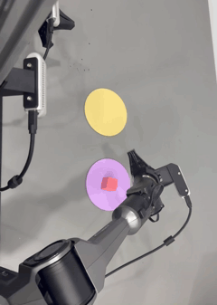
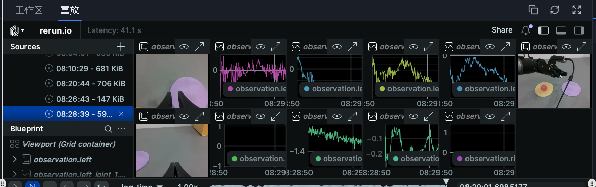
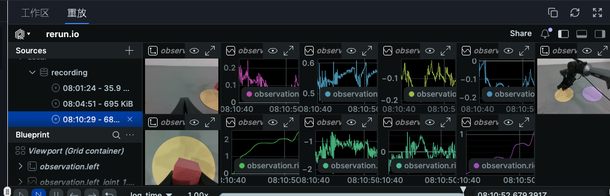
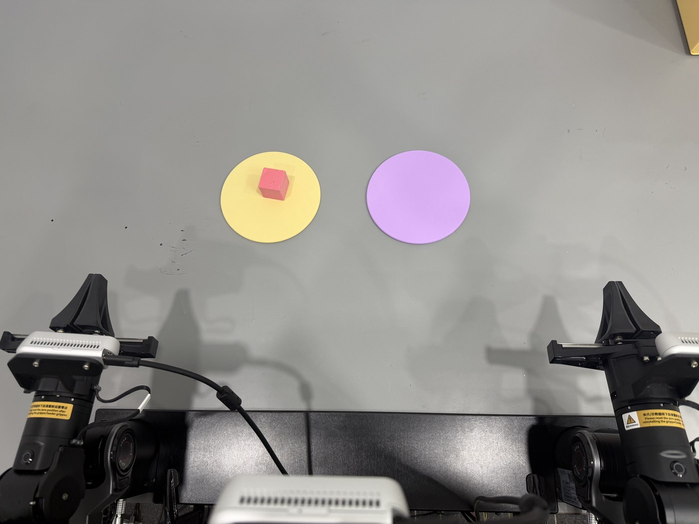
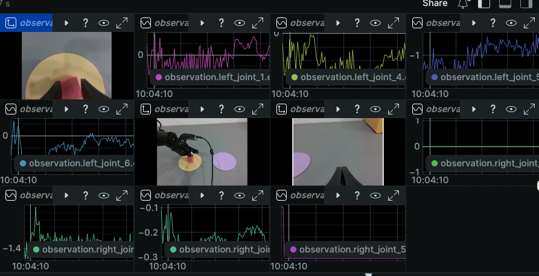

<div align="center">

# PiPER Dual-Arm Cube Transfer

**Two AgileX PiPER arms, two independent ACT policies, one resident control loop —<br>
with Rerun telemetry that doesn't slow the robot down.**

[](LICENSE)
[](https://www.python.org/)
[](https://github.com/huggingface/lerobot)
[](https://rerun.io/)
[](#hardware)


<sub>One cycle of the bidirectional loop: the leading arm picks the cube off the yellow pad and places it on the purple one.</sub>

</div>

**English** · [中文](README_zh.md)

---

## What this is

A complete, working **bidirectional pick-and-place** stack for a bimanual PiPER setup:

- **Two ACT policies**, one per direction. Left→right is driven by the *left* arm, right→left by the *right* arm. The idle arm holds position, which lets each policy be trained on a much narrower problem than a single "do both directions" model.
- **A resident loop runner** that loads both policies once, connects the robot once, and then alternates `l2r` → reset → `r2l` → reset for up to 10 cycles (20 stages) without re-initialising anything between stages.
- **Temporal ensembling at inference** (`n_action_steps=1`, `temporal_ensemble_coeff=0.01`) on top of policies trained with `n_action_steps=50` — the ensemble average is what makes the motion smooth rather than the raw chunk.
- **A Rerun telemetry path** that logs all 42 joint signals per step plus three camera streams, and an overlay (`launch/fast/`) that fixes a real, measured control-loop stall caused by Rerun's synchronous `rr.log()`.
- **A camera fan-out** that hands the three V4L2 cameras between the idle preview and the task process, so a task can take the cameras without a device-busy race.

It was developed on a physical workstation driving two PiPER arms over CAN, and everything in `launch/`, `loop_runner/` and `ops/` ran on that hardware. The repository is a cleaned-up extraction: no weights, no datasets, no recordings, no credentials.

---

## Demos

The clip at the top of this page is the **left** arm carrying the cube left→right. Below is the other half of the loop — the **right** arm carrying it back.



<sub>Right→left, on the bench rig. Real time, no speed-up.</sub>

Both directions run back to back inside one process, with only the arm that just moved being reset in between — see [How it works](#how-it-works). The full 62-second recording of a multi-stage run, resets included, is [`assets/loop_full_recording.mp4`](assets/loop_full_recording.mp4) (1.6 MB, H.264). GitHub does not play MP4 files inline from a repository, so that one is a download rather than a player.

---

## Table of contents

- [Demos](#demos)
- [Results, honestly](#results-honestly)
- [Hardware](#hardware)
- [How it works](#how-it-works)
- [Repository layout](#repository-layout)
- [Installation](#installation)
- [Configuration](#configuration)
- [Quick start](#quick-start)
- [Script reference](#script-reference)
- [Training your own policies](#training-your-own-policies)
- [Simulator](#simulator)
- [Rerun telemetry](#rerun-telemetry)
- [Troubleshooting](#troubleshooting)
- [Limitations and roadmap](#limitations-and-roadmap)
- [Safety](#safety)
- [License and acknowledgements](#license-and-acknowledgements)

---

## Results, honestly

This project does **not** publish a success rate, because the loop logs record only `time`, `state` and `action` per step — they cannot be turned into a pass/fail rate without inventing one. What follows is what was actually observed.

| Capability | Status | Notes |
|---|---|---|
| Single left→right transfer | **Runs on hardware** | Picks the cube off the start pad and places it on the far pad. Occasionally releases early — see [Limitations](#limitations-and-roadmap). |
| Single right→left transfer | **Runs on hardware** | Same loop, opposite policy. |
| 20-stage bidirectional loop | **Runs end to end** | Stage log reaches `STAGE n/20` for n = 18–20 before the run is stopped; `RESET_DONE <arm>` is printed between stages. |
| Dry-run self-checks (`--plan`, `--offline-check`) | **Pass, no hardware** | `--offline-check` prints `OFFLINE_CHECK_PASS` without opening CAN or the cameras. |
| Rerun live view | **Works** | 42 scalar curves + 3 camera streams reach the viewer. |
| Rerun fast overlay (`launch/fast/`) | **Unit-checked only** | `probe_fastlog.py unit` passes; the three `*_fast.sh` launchers have **never** run on hardware. Do not read it as "verified to help". |
| Success rate | **Not measured** | See the note above. |

Both directions, as they appear in the viewer during a run — the two camera panes show the pads, the two plot rows show the joint signals:

| Left→right — the left arm's joints are the busy ones | Right→left — the right arm's |
|---|---|
|  |  |

Two measured numbers worth keeping, because they are what motivated `launch/fast/`:

| Run | Steps/s | ms per step | p95 | worst single step |
|---|---|---|---|---|
| Without Rerun | 26.2 Hz | 38.1 ms | ~57 ms | 185 ms |
| With Rerun, before the fix | 16.1 Hz | 62.0 ms | 270 ms | **1144 ms** |
| With Rerun, on a *different* day, before the fix | 25.6 Hz | 39.0 ms | ~55 ms | 189 ms |

The third row is the interesting one: "Rerun is slow" was never the real story. The loop degrades *over time* — it runs fine, then drifts, then freezes for up to a second. See [docs/RERUN_PERFORMANCE.md](docs/RERUN_PERFORMANCE.md) for the root cause and the fix.

---

## Hardware



<sub>The bench: two PiPER arms, a start pad (yellow) and a goal pad (purple). The cube is the pink block.</sub>

| Item | Detail |
|---|---|
| Robot | 2 × AgileX **PiPER** 6-DoF arms + parallel grippers |
| Connection | CAN bus — `can1` = left arm, `can0` = right arm |
| Cameras | 3 × USB RGB, 640×480 @ 30 fps, addressed through `/dev/camera_left`, `/dev/camera_middle`, `/dev/camera_right` |
| Compute | x86 workstation with an NVIDIA GPU (ACT inference runs on `cuda`) |
| Optional | A leader-arm teleoperation pair (`piper_dual_leader`) for recording demonstrations |

The three camera devices are **stable symlinks**, not raw `/dev/videoN` numbers. Both the launchers and the loop runner resolve them at start-up and then hand OpenCV the numeric index — see [docs/HARDWARE.md](docs/HARDWARE.md) for the udev rule and the mounting geometry.

**Nothing in this repository opens the CAN bus or a camera unless you run one of the motion commands.** The dry-run paths are explicitly hardware-free.

---

## How it works

One line:

```
launch/*.sh  →  PiPERDual (CAN + 3 cameras)  →  ACT policy  →  actions @ 30 Hz
                        ↓
              Rerun: 42 scalars + 3 image streams
```

The parts that are worth explaining:

**Two directional policies, not one.** A single policy that had to learn "move the cube either way depending on which arm is holding it" spends most of its capacity on a decision that a human operator can make for free. Splitting it means each policy sees a nearly-static idle arm — and *that* creates its own problem, dealt with below.

**Normalisation flooring for the idle arm.** With one arm holding still, the standard deviation of its `observation.state` dimensions collapses towards zero. ACT normalises inputs by those statistics, so a near-zero σ turns tiny sensor noise into huge normalised values, and the policy becomes hypersensitive to a signal that carries no information. The training scripts (`launch_original/train_cube_l2r_50k.sh`, `train_cube_r2l_v3.sh`) therefore rewrite `meta/stats.json` before training and floor the idle arm's σ — `0.05` for position, `0.10` for effort — keeping a byte-exact backup of the original file. `observation.state` is 28-dimensional: for each of the two arms, six joints plus a gripper, each contributing `pos` and `effort` interleaved (`0,2,4…` = position, `1,3,5…` = effort).

**A data-direction sanity gate.** Before training the left-arm policy, the script reads the merged parquet back and asserts that the *left* arm's action range exceeds the right's. If a recording session was mislabelled, training stops before it wastes GPU hours on a policy that learned the wrong arm. This gate has earned its keep.

**Temporal ensembling at inference.** The policies train with `chunk_size=100, n_action_steps=50`, but they are *executed* with `n_action_steps=1` and `temporal_ensemble_coeff=0.01`, i.e. at every timestep the policy re-predicts a 100-step chunk and the executed action is an exponentially-weighted average over all overlapping predictions. The weight decays as `w_i = exp(-coeff × i)`. That is what produces the smooth trajectory — nothing else smooths the output (`PIPER_ACTION_FILTER_ALPHA=1` disables the extra action filter, precisely because the ensemble already handles it).

**A resident runner.** Re-connecting the CAN bus, reloading two policies and rebuilding the processors between stages costs seconds and adds a failure mode. `loop_runner/resident_new_env.py` connects once, keeps both policies and all three processors in memory, and only resets the arm that just moved. A lock file prevents an old and a new entry point from racing for the same CAN bus and cameras.

For more detail see [docs/ARCHITECTURE.md](docs/ARCHITECTURE.md).

---

## Repository layout

| Path | Contents |
|---|---|
| `config/env.sh` | **Every path in this repository is defined here.** Sourced by every launcher. |
| `launch/` | The launchers you actually run: single-shot and loop, with and without Rerun. |
| `launch/fast/` | The Rerun performance overlay (background-thread logging, camera downsampling). |
| `launch_original/` | The original training and recording scripts, kept for provenance. |
| `loop_runner/` | The bidirectional loop runner and its predecessors, plus unit self-checks. |
| `ops/` | Reset-to-start-pose tools, and the camera fan-out publisher. |
| `lerobot_snapshot/` | Read-only snapshot of the LeRobot-side files this project modifies. |
| `tools/log2png.py` | Renders a loop log (`.jsonl`) into a PNG plot. |
| `docs/` | Architecture, hardware, Rerun deep-dive, troubleshooting. |
| `sim/` | The MuJoCo replica of the cell: data generation, sim training entries, domain-gap probes. |
| `assets/meshes/` | The two arms' STL meshes, referenced by `sim/scene.xml` as `../assets/meshes`. |

`lerobot_snapshot/` is a *snapshot*, not a fork: it mirrors the paths inside the LeRobot source tree so you can diff it against your own checkout. The files are Apache-2.0, Copyright The HuggingFace Team — see [NOTICE](NOTICE).

---

## Installation

### 1. Clone

```bash
git clone https://github.com/<your-account>/piper-dual-arm-cube-transfer.git
cd piper-dual-arm-cube-transfer
```

### 2. Get a LeRobot checkout with PiPER support

The control stack is [LeRobot](https://github.com/huggingface/lerobot). This project adds the PiPER robot, teleoperator and motor drivers to it. Copy the snapshot over your checkout:

```bash
LEROBOT_REPO=$HOME/VLA/lerobot_piper
cp -r lerobot_snapshot/scripts/piper_cube_record.py   $LEROBOT_REPO/src/lerobot/scripts/
cp -r lerobot_snapshot/utils/visualization_utils.py   $LEROBOT_REPO/src/lerobot/utils/
cp -r lerobot_snapshot/robots/piper_dual/             $LEROBOT_REPO/src/lerobot/robots/
cp -r lerobot_snapshot/teleoperators/piper_dual_leader/ $LEROBOT_REPO/src/lerobot/teleoperators/
cp -r lerobot_snapshot/motors/piper/                  $LEROBOT_REPO/src/lerobot/motors/
```

`visualization_utils.py` is where the Rerun logging hook lives; `piper_cube_record.py` is the record/inference entry point that calls it.

### 3. Python environment

```bash
conda create -n lerobot_v30 python=3.10 -y
conda activate lerobot_v30
pip install -e $LEROBOT_REPO        # LeRobot itself
pip install -r requirements.txt     # the extras this repo's tooling needs
```

The one version pin that matters: **Rerun ≥ 0.31.3**. Older SDKs have no `rr.Scalars` and no `rr.set_sinks`, so `--display_data=true` fails at start-up with an `AttributeError`.

### 4. Cameras and CAN

```bash
# udev symlinks so the three cameras can't swap places between reboots
sudo cp ops/fanout/scripts/99-piper-cameras.rules /etc/udev/rules.d/   # example rule, edit first
sudo udevadm control --reload && sudo udevadm trigger

# bring both CAN interfaces up at 1 Mbit/s
sudo ip link set can0 up type can bitrate 1000000
sudo ip link set can1 up type can bitrate 1000000
```

Verify before running anything:

```bash
ls -l /dev/camera_left /dev/camera_middle /dev/camera_right
ip -details link show can0
```

### 5. Configure

Point `config/env.sh` at your machine — either export the variables or drop a `config/env.local.sh` (git-ignored):

```bash
cat > config/env.local.sh <<'EOF'
export PIPER_WS=$HOME/robots/piper-lab
export LEROBOT_REPO=$HOME/lerobot
export LEROBOT_ENV=$HOME/miniconda3/envs/lerobot_v30
EOF
```

Nothing else in the tree contains a hard-coded path.

---

## Configuration

All variables live in [`config/env.sh`](config/env.sh) and can be overridden per-invocation.

| Variable | Default | Meaning |
|---|---|---|
| `PIPER_WS` | `$HOME/VLA` | Working tree for data: checkpoints, datasets, recordings. |
| `LEROBOT_REPO` | `$PIPER_WS/lerobot_piper` | The LeRobot checkout. |
| `LEROBOT_ENV` | `$HOME/miniconda3/envs/lerobot_v30` | Conda **prefix** of the control environment. Nothing calls `conda activate`. |
| `LEROBOT_HOME` | `$HOME/.cache/huggingface/lerobot` | Where `local/<name>` datasets and stats resolve. |
| `PIPER_FANOUT_ROOT` | `<repo>/ops/fanout` | Camera fan-out code. |
| `CUBE_ENVFIX_ROOT` | `<repo>/launch` | Where the launchers look for `rerun_env.sh`. |
| `CUBE_RERUN_SAVE_DIR` | `$PIPER_WS/rerun_data` | Where `.rrd` recordings are written. |
| `CUBE_RUNNER_LOCK` | *(empty)* | Lock file that serialises entry points taking the CAN bus and cameras. Empty = each runner derives it from the repo root. |
| `RERUN_SDK_ROOT` | *(empty)* | Optional vendored Rerun SDK to shadow the environment's. |
| `PIPER_IDLE_FANOUT_SH` | *(empty)* | Optional script owning an idle camera preview. |

Per-run knobs, all with defaults:

| Variable | Default | Meaning |
|---|---|---|
| `CUBE_RERUN_FAST` | `1` | `off` disables the whole overlay — behaviour returns to exactly what it was. |
| `CUBE_RERUN_MODE` | `async` | `async` = log off the control thread; `sync` = log in place, downsampled. |
| `CUBE_RERUN_IMG_HZ` | `5` | Camera frame rate into Rerun. Joint curves stay at 30 Hz. `0` = no images. |
| `CUBE_RERUN_QUEUE` | `3` | Async queue depth; when full, the oldest entry is dropped. |
| `CUBE_RERUN_SAVE` | `1` | `off` = keep the live view but write no `.rrd`. |
| `CUBE_RERUN_IP` / `CUBE_RERUN_PORT` | `127.0.0.1` / `9876` | Viewer address. |

---

## Quick start

### Hardware-free checks — run these first

```bash
# 1) Is the control interpreter the one you think it is?
"$LEROBOT_ENV/bin/python" -c "import rerun; print(rerun.__version__)"

# 2) Print the 20-stage plan, touch nothing
bash launch/cube_loop_rerun.sh --plan

# 3) Full self-check: loads both policies, builds the observation schema,
#    runs the loop against a fake robot. Opens no CAN, no camera.
bash launch/cube_loop_rerun.sh --offline-check
# -> OFFLINE_CHECK_PASS; no robot instantiated, no cameras/CAN opened
```

`--offline-check` exiting 0 is the strongest guarantee this repository can give you without moving metal.

### Motion commands

> 🛑 **Every command below energises and moves both arms.** Clear the workspace, support the arms if they are not on a rigid mount, keep the emergency stop within reach, and keep hands out of the envelope. Each launcher prints this warning and the checkpoint it is about to load before it does anything.

```bash
# Single transfer, left arm carries left -> right
bash launch/act_inference_cube_l2r_rerun.sh

# Single transfer, right arm carries right -> left
bash launch/act_inference_cube_r2l_rerun.sh

# Bidirectional loop: up to 10 cycles (20 stages), 15 s per stage
bash launch/cube_loop_rerun.sh
```

Stop the loop by typing `stop` + Enter in its terminal, or `Ctrl+C`. Stopping is deliberate about what it does *not* do: it finishes no further stage and performs no extra return-home motion, so the arms may be left enabled and mid-pose. Reset them explicitly if you need to.

```bash
# Reset both arms to the training start pose.
# ⚠️ Also moves the arms immediately — --execute is hard-coded.
bash ops/reset_piper_pose.sh
```

To see the joint curves and camera streams while a run is in progress, open the Rerun viewer at `rerun+http://$CUBE_RERUN_IP:$CUBE_RERUN_PORT`.

---

## Script reference

### `launch/` — the entry points

| Script | Runs | Rerun | Hardware |
|---|---|---|---|
| `act_inference_cube_l2r_rerun.sh` | Left→right, one episode (15 s) + reset | yes | **moves** |
| `act_inference_cube_r2l_rerun.sh` | Right→left, one episode (15 s) + reset | yes | **moves** |
| `cube_loop_rerun.sh` | The resident 20-stage loop | yes | **moves** |
| `cube_loop_new_env_fixed.sh` | Loop, environment fixed, no Rerun (kept for reference) | no | **moves** |
| `act_inference_cube_r2l_new_env_20k_fixed.sh` | Single shot, no Rerun (kept for reference) | no | **moves** |
| `rerun_env.sh` | Sourced helper: optional SDK pin, bytecode cache, viewer address | — | no |
| `resident_new_env_rerun.py` | The loop runner with `init_rerun()` wired in | — | — |
| `probe_rerun.py` | Sends synthetic data to the viewer — proves the link, with no hardware | — | no |
| `probe_rerun_paths.py` | Monkey-patches `rerun.log` to dump the entity paths actually written | — | no |
| `probe_rerun_volume.py` | Pushes tens of MB and samples the server's RSS, to prove data *arrives* | — | no |

### `launch/fast/` — the Rerun overlay

| Script | Purpose |
|---|---|
| `fast_env.sh` | Prepends this directory to `PYTHONPATH`, restores the 1 MiB flush threshold, sets the four knobs. |
| `sitecustomize.py` | Patches `log_rerun_data` at interpreter start-up — **before** `piper_cube_record.py` binds it by name. |
| `cube_fastlog.py` | The fast logger: every scalar per step, images downsampled, ndarray copied, non-blocking `put_nowait` into a bounded queue, background thread calls the *original* function. |
| `cube_rerun_archive.py` | Adds a `FileSink` next to the live gRPC sink. |
| `*_fast.sh` | Three thin wrappers that source `fast_env.sh` and exec the original launcher. |
| `probe_fastlog.py` | No-hardware verification: `unit`, `blackhole`, `timing`, `file`, `compare`. |
| `probe_archive.py` | Drives the *production* `init_rerun` path (the one `sitecustomize.py` wraps) to prove both sinks are live at once. Exit code 2 = the patch never loaded. |

### `loop_runner/`

| Script | Purpose |
|---|---|
| `resident_new_env.py` | **The loop.** `loop` / `l2r` / `r2l` modes, `--cycles 1..10`, `--plan`, `--offline-check`. |
| `resident.py`, `run_cube.py` | Earlier runners, kept for reference. |
| `cube*.sh`, `cube_*_reset.sh` | Thin wrappers around the above. |
| `test_resident*.py`, `test_runner.py` | Unit self-checks for the runners. |
| `view_three_cameras.py`, `view_right_camera.py` | Camera preview for debugging. **These hold the cameras; nothing else can run while they do.** |

### `ops/`

| Script | Purpose |
|---|---|
| `reset_piper_pose.py` | Reset to the start pose. `--arm left\|right\|both` is required; **without `--execute` it is a dry run** that reads and enables nothing. |
| `reset_piper_pose.sh` | Fixed wrapper: both arms, speeds 0.20 / 0.01, `--execute`. **Moves immediately.** |
| `reset_piper_both_auto5s.sh` | Same reset, but it first checks that no controller process (`lerobot-record`, …) is still alive, then writes a full log and verifies the run's success marker. |
| `fanout/` | The camera publisher: hands V4L2 devices between the idle preview and the task, publishes RGB over TCP for remote viewing, and can install itself as a systemd unit. |

---

## Training your own policies

The scripts in `launch_original/` are the real ones that produced the two deployed policies. The lineage:

| Policy | Dataset | Base | Steps | LR | Output |
|---|---|---|---|---|---|
| Left arm (L→R) | `local/cube_l2r_left_arm_dataset_v1_robust` (5 sessions merged, 50 episodes) | from scratch | 50 000 | 1e-5 | `outputs/train/cube_l2r_left_arm_act_v1_robust_c100` |
| Right arm (R→L) | `local/cube_r2l_dataset_v2_robust` (50 episodes) | from scratch | 50 000 | 1e-5 | `outputs/train/cube_r2l_act_v2_robust_c100` |
| Right arm, finetune | `local/cube_r2l_dataset_v3_80ep` (80 episodes) | `cube_r2l_act_v2_robust_c100/050000` | 20 000 | 3e-6 | `outputs/train/cube_r2l_act_v3_80ep_ft20000` |
| Right arm, generalized | `local/cube_r2l_dataset_robust_v1` | `cube_r2l_act_v2_robust_c100/040000` | 20 000 | 3e-6 | `outputs/train/cube_r2l_generalized_ft20k` |

Common ACT settings: `chunk_size=100`, `n_action_steps=50`, `n_obs_steps=1`, `batch_size=8`, `eval_freq=0`, `wandb.enable=false`. Inference then switches to `n_action_steps=1` with `temporal_ensemble_coeff=0.01` (see [How it works](#how-it-works)).

Both training scripts are **destructive-by-design about re-runs**: they refuse to start if the merge target or the output directory already exists, rather than silently overwriting a checkpoint. Keep that property if you adapt them.

The checkpoint the launchers load is set in two places — the shell variable `CHECKPOINT` at the top of each `launch/*.sh`, and the `CHECKPOINTS` dict in `loop_runner/resident_new_env.py`. Change both if you train a new policy.

---

## Simulator

`sim/` is a MuJoCo replica of the same cell, built for two purposes: making training data without occupying the arms, and measuring what a policy does when the pictures come from the simulator instead of the cameras.

The mechanism is replay. A recorded demonstration is played back through the physics engine, and the renders are written out as a lerobot v3.0 dataset with the identical schema — 14-dim action, 28-dim state, three 480×640 cameras, 30 fps. Each episode randomises the surfaces, the two lights, where the cube is put down, its mass and friction, and both arms' start pose, so none of that becomes something the policy can key on. A take runs twice: cameras off to check that it lands, then cameras on to record it — that double pass is where the ~89 s per episode goes. `sim/piper_dual_sim.py` exposes the same call surface as the real `piper_dual` robot, so the recording loop drives either one unchanged.

| Command (from `sim/`) | What it does |
|---|---|
| `gen_sim_data.py --episodes 80 --out cube_sim_v1` | Records 80 episodes into the lerobot cache. `CUBE_SIM_LENS=1` additionally applies the fitted lens model. |
| `train_sim_act.sh` / `train_sim_act.sh --from-scratch` | Trains ACT on sim data; without the flag it fine-tunes from a real-data checkpoint, with it the run starts cold. |
| `train_mix_act.sh` | Trains on the merged real + sim dataset. |
| `policy_probe*.py` | Replays one demonstration through picture variants and reports how far the policy drifts. |

It needs MuJoCo with EGL (`MUJOCO_GL=egl`), `imageio`, and lerobot 0.4.4. The arm meshes live in `assets/meshes/`, next to `sim/`, because `scene.xml` points at them as `../assets/meshes`. `ROOT` (the demonstration dataset) and `CKPT` (the starting checkpoint) are absolute paths from the lab machine — change them before running anywhere else. [`sim/README.md`](sim/README.md) lists every file.

What it has shown so far. Trained on real + sim data, the policy transfers to the bench: 3/3 stages on hardware, checked frame by frame. Trained on sim data alone but fine-tuned from a real checkpoint, it solves 5/5 trials inside the simulator. A cold start from simulated pictures alone does **not** transfer — fed recorded frames, the same weights drift 0.220 rad mean against 0.010 rad on rendered ones, the commanded motion shrinks to a third of the demonstration's span, and in closed loop the output collapses to the dataset's mean pose. Matching the colour statistics of the recorded frames before inference changes nothing (0.220 → 0.228 rad), so the gap is in what the pictures contain, not how they are tinted.

---

## Rerun telemetry

Every step logs **42 scalar curves** — 28 observation dimensions and 14 action dimensions — plus three camera streams, under the entity names `observation.*` and `action.*`.



<sub>A few seconds of the 42 curves, next to the camera panes. The flat green line is the idle arm — the normalisation-flooring problem in [How it works](#how-it-works) starts here.</sub>

Recordings can be written to disk and reopened later:

```bash
rerun recording.rrd          # or: python -m rerun recording.rrd
```

`.rrd` files and a `.cmd.txt` beside each one (the exact command line that produced it) land in `$CUBE_RERUN_SAVE_DIR`.

**The performance story is the most transferable thing in this repository.** Short version: `rr.log()` executes on the caller's thread and blocks when the SDK's send channel hits its byte budget — and the caller is the 30 Hz control loop. The loop doesn't get uniformly slower; it degrades until a single step takes over a second.

The fix in `launch/fast/` is three changes, only one of which is load-bearing:

1. **Move `log_rerun_data` off the control thread** into a background thread behind a bounded queue that drops the oldest entry when full. The control thread only classifies, copies and enqueues — it never blocks. This is the actual fix.
2. **Downsample camera frames to 5 Hz.** Camera entities are overwrite-only, so at 30 Hz twenty-nine of every thirty frames were pure waste anyway.
3. **Raise the flush threshold from 8000 bytes back to the SDK default of 1 MiB**, cutting send calls by two orders of magnitude. No code change — one environment variable.

Rollback is one prefix: `CUBE_RERUN_FAST=off bash launch/cube_loop_rerun_fast.sh`.

Full root-cause analysis, the file-and-line evidence trail, and what remains unverified: **[docs/RERUN_PERFORMANCE.md](docs/RERUN_PERFORMANCE.md)**.

---

## Troubleshooting

The failures that actually cost time on this project — cameras held by a stale process, a container whose GPU passthrough silently disappears, a Python environment that exists at two different paths, a viewer that shows nothing because the process is writing to a sink that replaced the live one:

**[docs/TROUBLESHOOTING.md](docs/TROUBLESHOOTING.md)**

Two commands that resolve most of it:

```bash
bash launch/cube_loop_rerun.sh --offline-check   # is the software stack healthy?
ls -l /dev/camera_* /dev/video*                  # are the cameras where you think?
```

---

## Limitations and roadmap

**Known defects.**

- **Left→right can release the cube early**, dropping it from height so that it bounces off the pad and is lost. The loop treats that stage as failed and resets. Changing `temporal_ensemble_coeff` and `n_action_steps` was tried and made things *worse*, so both were reverted; the cause has not been identified in configuration space. This is the main open problem.
- **Reset can trip a gripper safety stop.** The reset starts with the gripper open and the arm still low, which can raise `gripper tracking error` and halt the run.
- **The fast overlay is not validated on hardware.** It is unit-checked and its failure mode is designed to be benign, but "designed to be safe" is not "observed to be safe". Treat the first hardware run of it as an experiment.

**Not attempted yet.** No success-rate instrumentation (the loop log should record pass/fail, and it doesn't); no recovery behaviour for a dropped cube — a failed stage resets rather than retries; single-direction policies only, no unified bidirectional model.

**Housekeeping.** The repository's own CI is absent; the dry-run self-checks are the substitute and they only cover the software stack, not the arms.

---

## Safety

Read this before running anything in `launch/` or `ops/`.

- The three inference launchers and both reset scripts **energise and move the arms**. Clear the workspace, verify the emergency stop works, and keep hands out of the reachable envelope.
- `ops/reset_piper_pose.sh` and `reset_piper_both_auto5s.sh` move **both** arms at once. Confirm nobody is near the workspace first.
- `ops/reset_piper_pose.py` without `--execute` is a genuine dry run — it neither enables nor moves. Prefer it while you are still figuring out poses.
- Do not modify model weights, datasets, normalisation statistics, control parameters, or the safety checks (`--reset_gripper_tracking_limit` and friends) to "make a stage pass".
- Only one process may hold the CAN interfaces and the cameras at a time. The loop takes a lock file for exactly this reason; the camera preview scripts take neither.
- This repository ships scripts and documentation only — no weights, no datasets, no video, no credentials.

---

## License and acknowledgements

Apache-2.0 — see [LICENSE](LICENSE). The files under `lerobot_snapshot/` are derived from [LeRobot](https://github.com/huggingface/lerobot) (Copyright The HuggingFace Team, Apache-2.0); see [NOTICE](NOTICE). The STL meshes in `assets/meshes/` are the PiPER arm model from AgileX's `piper_description` package and remain under their own terms.

Built on [LeRobot](https://github.com/huggingface/lerobot) for the policy stack, [Rerun](https://rerun.io/) for telemetry, and AgileX PiPER hardware driven over CAN.

If you use this work, see [CITATION.cff](CITATION.cff).
