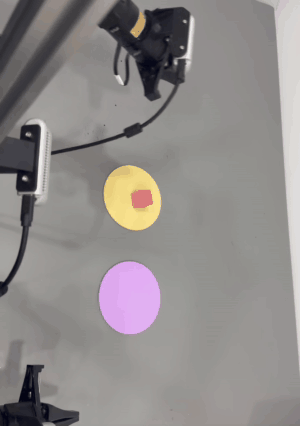

<div align="center">

# PiPER 双臂方块搬运

**两条 AgileX PiPER 机械臂，两个独立的 ACT 策略，一个常驻控制循环 ——<br>
外加一条不会拖慢机械臂的 Rerun 遥测链路。**

[](LICENSE)
[](https://www.python.org/)
[](https://github.com/huggingface/lerobot)
[](https://rerun.io/)
[](#硬件)



<sub>双向循环中的一个回合：执行臂把方块从黄色垫子拿起来，放到紫色垫子上。</sub>

</div>

> English version: **[README.md](README.md)**

---

## 这是什么

一套完整、跑得通的**双向抓放**系统，面向双臂 PiPER 平台：

- **两个 ACT 策略，一个方向一个**。左→右由**左臂**执行，右→左由**右臂**执行。不动的
  那条臂保持姿态，所以每个策略面对的问题比"一个模型管两个方向"窄得多。
- **常驻循环 runner**：两个策略只加载一次、机械臂只连接一次，然后 `l2r` → 归位 →
  `r2l` → 归位 交替跑，最多 10 轮（20 段），段与段之间不重新初始化任何东西。
- **推理期做时序集成**（`n_action_steps=1`、`temporal_ensemble_coeff=0.01`），而训练时用的是
  `n_action_steps=50`。动作之所以平滑，靠的是这个加权平均，不是原始 chunk。
- **Rerun 遥测链路**：每一步记录全部 42 路关节信号，外加三路相机画面；另有一层
  `launch/fast/` 专门修掉 Rerun 同步 `rr.log()` 引起的、实测到的控制循环卡顿。
- **相机推流与交接**：把三个 V4L2 相机在"空闲预览"和"任务进程"之间交接，任务开始前
  先把相机拿过来，退出时再还回去，避免设备占用冲突。

这套东西是在一台真机上、通过 CAN 驱动两条 PiPER 臂开发出来的。`launch/`、`loop_runner/`
和 `ops/` 里的东西都在这套硬件上跑过。本仓库是清理后的抽取版：**不含权重、数据集、
录像和任何凭据**。

---

## 目录

- [如实说明的实测结果](#如实说明的实测结果)
- [硬件](#硬件)
- [工作原理](#工作原理)
- [仓库结构](#仓库结构)
- [安装](#安装)
- [配置](#配置)
- [快速上手](#快速上手)
- [脚本速查](#脚本速查)
- [训练自己的策略](#训练自己的策略)
- [Rerun 遥测](#rerun-遥测)
- [排错](#排错)
- [已知缺陷与后续计划](#已知缺陷与后续计划)
- [安全](#安全)
- [许可与致谢](#许可与致谢)

---

## 如实说明的实测结果

本仓库**不发布成功率**。循环日志每步只记 `time` / `state` / `action`，从这些数据里
算不出成功/失败，硬算就等于编造。下面写的都是实际观察到的。

| 能力 | 状态 | 说明 |
|---|---|---|
| 单次左→右 | **真机跑通** | 能抓起方块放到对面垫子上。偶尔**松手偏早**，见[已知缺陷](#已知缺陷与后续计划)。 |
| 单次右→左 | **真机跑通** | 同一套循环，换相反方向的策略。 |
| 20 段双向循环 | **能连续跑** | 日志里 `STAGE n/20` 一直打到 18~20 段才被停；段间有 `RESET_DONE <arm>`。 |
| 干跑自检（`--plan`、`--offline-check`） | **通过，不碰硬件** | `--offline-check` 打印 `OFFLINE_CHECK_PASS`，全程不开 CAN、不开相机。 |
| Rerun 实时上屏 | **可用** | 42 条曲线 + 3 路相机画面能到查看器。 |
| Rerun 快版（`launch/fast/`） | **只过了单元自检** | `probe_fastlog.py unit` 通过；三个 `*_fast.sh` **从未在真机上跑过**。别把它当成"已验证能提升成功率"。 |
| 成功率 | **没有测量** | 见上。 |

有两个值得留档的实测数字，因为正是它们引出了 `launch/fast/`：

| 运行 | 频率 | 每步 | p95 | 单步最大 |
|---|---|---|---|---|
| 不带 Rerun | 26.2 Hz | 38.1 ms | ~57 ms | 185 ms |
| 带 Rerun（修复前） | 16.1 Hz | 62.0 ms | 270 ms | **1144 ms** |
| 带 Rerun（修复前，**另一天**） | 25.6 Hz | 39.0 ms | ~55 ms | 189 ms |

第三行才是关键：**"带 Rerun 就一定慢"这个模型是错的**。真实表现是会**越跑越退化**——
先正常，再变慢，然后卡住将近一秒。根因与修复见
[docs/RERUN_PERFORMANCE.md](docs/RERUN_PERFORMANCE.md)。

---

## 硬件

| 项目 | 说明 |
|---|---|
| 机械臂 | 2 × AgileX **PiPER** 六自由度臂 + 平行夹爪 |
| 连接 | CAN 总线 —— `can1` = 左臂，`can0` = 右臂 |
| 相机 | 3 × USB RGB，640×480 @ 30 fps，通过 `/dev/camera_left`、`/dev/camera_middle`、`/dev/camera_right` 访问 |
| 主机 | x86 + NVIDIA 显卡（ACT 推理跑在 `cuda` 上） |
| 可选 | 一对主臂（`piper_dual_leader`）用于遥操采集示教数据 |

三个相机是**固定的软链接**，不是裸 `/dev/videoN` 编号。启动脚本与循环 runner 都在启动时
解析软链接、再换算成 OpenCV 要的数字索引 —— udev 规则与安装几何见
[docs/HARDWARE.md](docs/HARDWARE.md)。

**除非你运行会动臂的命令，本仓库不会打开 CAN 总线或任何相机。** 干跑路径是明确无硬件的。

---

## 工作原理

一句话：

```
launch/*.sh  →  PiPERDual（CAN + 三路相机）  →  ACT 策略  →  30 Hz 动作输出
                        ↓
              Rerun：42 条曲线 + 3 路图像流
```

几处值得展开的设计：

**为什么是两个方向策略，而不是一个。** 一个"看情况决定把方块往哪搬"的策略，会把大部分
容量花在一个人工一秒钟就能决定的事情上。拆开之后每个策略只面对一条近乎不动的臂 —— 而这
本身又带来下面这个问题。

**不动那条臂的归一化下限。** 一条臂全程静止时，它的 `observation.state` 各维标准差会塌向 0。
ACT 用这些统计量归一化输入，σ 接近 0 就等于放大小噪声：不动那条臂的维度会被传感器噪声和
量化误差主导，策略对一条不含任何任务信息的通道过度敏感。所以训练脚本
（`launch_original/train_cube_l2r_50k.sh`、`train_cube_r2l_v3.sh`）在训练前改写
`meta/stats.json`，给不动那条臂的 σ 加下限 —— 位置 `0.05`、力矩 `0.10` —— 并把原文件
逐字节备份。`observation.state` 是 28 维：两条臂各六个关节加一个夹爪，每个贡献 `pos` 和
`effort`，交错排列（`0,2,4…` 是位置，`1,3,5…` 是力矩）。

**一道数据方向闸门。** 训练左臂策略前，脚本会把合并后的 parquet 读回来，断言**左**臂的
动作幅度大于右臂。如果某个采集会话标签写错了，训练会在浪费 GPU 小时之前停下来。这道闸门
是真派上过用场的。

**推理期时序集成。** 策略训练时 `chunk_size=100, n_action_steps=50`，执行时却是
`n_action_steps=1` 配 `temporal_ensemble_coeff=0.01` —— 每一步都用策略重新预测一个 100 步
chunk，真正下发的动作是对所有覆盖当前步的预测做指数加权平均，权重按
`w_i = exp(-coeff × i)` 衰减。平滑就是从这里来的，别处没有再平滑一次
（`PIPER_ACTION_FILTER_ALPHA=1` 关掉了额外的动作滤波，正因为集成已经干了这件事）。

**常驻 runner。** 段与段之间重连 CAN、重载两个策略、重建处理器要花几秒，还多一个失败点。
`loop_runner/resident_new_env.py` 只连一次、两个策略和三个处理器一直留在内存里，每次只把
刚刚动过的那条臂归位。有锁文件防止新旧入口同时起来抢同一条 CAN 总线和相机。

更多细节见 [docs/ARCHITECTURE.md](docs/ARCHITECTURE.md)。

---

## 仓库结构

| 路径 | 内容 |
|---|---|
| `config/env.sh` | **本仓库所有路径都在这里定义。** 每个启动脚本都 source 它。 |
| `launch/` | 真正要跑的启动脚本：单次/循环，带 Rerun/不带 Rerun。 |
| `launch/fast/` | Rerun 性能层（后台线程记录 + 相机降频）。 |
| `launch_original/` | 原始训练与采集脚本，留作出处。 |
| `loop_runner/` | 双向循环 runner 本体与它的上一代，外加单元自检。 |
| `ops/` | 归位工具，以及相机推流发布器。 |
| `lerobot_snapshot/` | 本项目改动过的 LeRobot 侧文件只读快照。 |
| `tools/log2png.py` | 把循环日志（`.jsonl`）画成 PNG。 |
| `docs/` | 架构、硬件、Rerun 深入、排错。 |

`lerobot_snapshot/` 是**快照**不是 fork：目录结构与 LeRobot 源码树一一对应，方便你直接
和自己的 checkout 做 diff。这些文件是 Apache-2.0，版权归 The HuggingFace Team —— 见
[NOTICE](NOTICE)。

---

## 安装

### 1. 克隆

```bash
git clone https://github.com/<你的账号>/piper-dual-arm-cube-transfer.git
cd piper-dual-arm-cube-transfer
```

### 2. 准备一份带 PiPER 支持的 LeRobot

控制栈是 [LeRobot](https://github.com/huggingface/lerobot)。本项目在它上面加了 PiPER 的
机器人、遥操臂与电机驱动。把快照覆盖过去：

```bash
LEROBOT_REPO=$HOME/VLA/lerobot_piper
cp -r lerobot_snapshot/scripts/piper_cube_record.py     $LEROBOT_REPO/src/lerobot/scripts/
cp -r lerobot_snapshot/utils/visualization_utils.py     $LEROBOT_REPO/src/lerobot/utils/
cp -r lerobot_snapshot/robots/piper_dual/               $LEROBOT_REPO/src/lerobot/robots/
cp -r lerobot_snapshot/teleoperators/piper_dual_leader/ $LEROBOT_REPO/src/lerobot/teleoperators/
cp -r lerobot_snapshot/motors/piper/                    $LEROBOT_REPO/src/lerobot/motors/
```

Rerun 的日志钩子在 `visualization_utils.py`，采集/推理入口是 `piper_cube_record.py`。

### 3. Python 环境

```bash
conda create -n lerobot_v30 python=3.10 -y
conda activate lerobot_v30
pip install -e $LEROBOT_REPO        # LeRobot 本体
pip install -r requirements.txt     # 本仓库工具链需要的额外包
```

唯一要卡的版本：**Rerun ≥ 0.31.3**。更老的 SDK 没有 `rr.Scalars`、也没有 `rr.set_sinks`，
`--display_data=true` 会在启动时直接 `AttributeError`。

### 4. 相机与 CAN

```bash
# udev 软链接，保证重启后三个相机不会互换（示例规则，先改成你自己的）
sudo cp ops/fanout/scripts/99-piper-cameras.rules /etc/udev/rules.d/
sudo udevadm control --reload && sudo udevadm trigger

# 两条 CAN 上都起来，1 Mbit/s
sudo ip link set can0 up type can bitrate 1000000
sudo ip link set can1 up type can bitrate 1000000
```

跑任何东西之前先核对：

```bash
ls -l /dev/camera_left /dev/camera_middle /dev/camera_right
ip -details link show can0
```

### 5. 配置

把 `config/env.sh` 指到你的机器上 —— 要么导出变量，要么写一个 `config/env.local.sh`
（已被 git 忽略）：

```bash
cat > config/env.local.sh <<'EOF'
export PIPER_WS=$HOME/robots/piper-lab
export LEROBOT_REPO=$HOME/lerobot
export LEROBOT_ENV=$HOME/miniconda3/envs/lerobot_v30
EOF
```

树里其他地方没有任何硬编码路径。

---

## 配置

所有变量都在 [`config/env.sh`](config/env.sh)，可以按次覆盖。

| 变量 | 默认值 | 含义 |
|---|---|---|
| `PIPER_WS` | `$HOME/VLA` | 数据工作区：checkpoint、数据集、录像。 |
| `LEROBOT_REPO` | `$PIPER_WS/lerobot_piper` | LeRobot checkout。 |
| `LEROBOT_ENV` | `$HOME/miniconda3/envs/lerobot_v30` | 控制环境的 conda **前缀**。没有一处调 `conda activate`。 |
| `LEROBOT_HOME` | `$HOME/.cache/huggingface/lerobot` | `local/<名字>` 数据集与统计量的解析位置。 |
| `PIPER_FANOUT_ROOT` | `<仓库>/ops/fanout` | 相机推流代码。 |
| `CUBE_ENVFIX_ROOT` | `<仓库>/launch` | 启动脚本找 `rerun_env.sh` 的地方。 |
| `CUBE_RERUN_SAVE_DIR` | `$PIPER_WS/rerun_data` | `.rrd` 录像写到哪里。 |
| `CUBE_RUNNER_LOCK` | *空* | 所有要占 CAN 与相机的入口共用的那把锁文件。留空＝各 runner 自己按仓库根推导。 |
| `RERUN_SDK_ROOT` | *空* | 可选：顶掉环境自带 Rerun 的外挂 SDK。 |
| `PIPER_IDLE_FANOUT_SH` | *空* | 可选：持有空闲相机预览的脚本。 |

每次运行的开关，都有默认值：

| 变量 | 默认值 | 含义 |
|---|---|---|
| `CUBE_RERUN_FAST` | `1` | `off` = 完全关掉这一层，行为回到改动前。 |
| `CUBE_RERUN_MODE` | `async` | `async` = 离开控制线程记录；`sync` = 原地记但降频。 |
| `CUBE_RERUN_IMG_HZ` | `5` | 相机画面进 Rerun 的频率。关节曲线仍是 30 Hz。`0` = 不记画面。 |
| `CUBE_RERUN_QUEUE` | `3` | 异步队列长度，满了丢最旧。 |
| `CUBE_RERUN_SAVE` | `1` | `off` = 保留实时上屏但不写 `.rrd`。 |
| `CUBE_RERUN_IP` / `CUBE_RERUN_PORT` | `127.0.0.1` / `9876` | 查看器地址。 |

---

## 快速上手

### 先跑不碰硬件的自检

```bash
# 1) 控制解释器是不是你以为的那个
"$LEROBOT_ENV/bin/python" -c "import rerun; print(rerun.__version__)"

# 2) 打印 20 段计划，什么都不碰
bash launch/cube_loop_rerun.sh --plan

# 3) 完整自检：加载两个策略、构建观测 schema、用假机器人跑一遍循环。
#    不开 CAN、不开相机。
bash launch/cube_loop_rerun.sh --offline-check
# -> OFFLINE_CHECK_PASS; no robot instantiated, no cameras/CAN opened
```

`--offline-check` 退出码 0，是本仓库在不动机器金属的前提下能给的最强保证。

### 会动臂的命令

> 🛑 **下面每条都会使能并移动双臂。** 跑前清空工作区；臂如果不是刚性固定，先支撑好；
> 急停随手可及；手不要伸进工作空间。每个启动脚本在做任何事之前都会先打印这条警告和
> 它即将加载的 checkpoint。

```bash
# 单次，左臂执行 左→右
bash launch/act_inference_cube_l2r_rerun.sh

# 单次，右臂执行 右→左
bash launch/act_inference_cube_r2l_rerun.sh

# 双向循环：最多 10 轮（20 段），每段 15 秒
bash launch/cube_loop_rerun.sh
```

停止循环：在运行终端里输入 `stop` 回车，或 `Ctrl+C`。停止的行为是刻意规定的：**不再起
下一段，也不做额外的回零动作**，所以双臂可能停在使能状态、停在半途。需要归位就显式跑一次。

```bash
# 双臂归位到训练起始位姿。
# ⚠️ 同样会立刻动臂 —— --execute 是写死的。
bash ops/reset_piper_pose.sh
```

跑的过程中想看关节曲线和相机画面，浏览器打开 `rerun+http://$CUBE_RERUN_IP:$CUBE_RERUN_PORT`。

---

## 脚本速查

### `launch/` —— 入口

| 脚本 | 作用 | Rerun | 硬件 |
|---|---|---|---|
| `act_inference_cube_l2r_rerun.sh` | 左→右单次（15 秒）+ 归位 | 有 | **会动** |
| `act_inference_cube_r2l_rerun.sh` | 右→左单次（15 秒）+ 归位 | 有 | **会动** |
| `cube_loop_rerun.sh` | 常驻 20 段循环 | 有 | **会动** |
| `cube_loop_new_env_fixed.sh` | 循环，只修环境、不带 Rerun（留档） | 无 | **会动** |
| `act_inference_cube_r2l_new_env_20k_fixed.sh` | 单次，不带 Rerun（留档） | 无 | **会动** |
| `rerun_env.sh` | 被 source 的辅助脚本：可选 SDK、字节码缓存、查看器地址 | — | 不 |
| `resident_new_env_rerun.py` | 接上 `init_rerun()` 的循环 runner | — | — |
| `probe_rerun.py` | 给查看器灌合成数据，证明链路通；不碰硬件 | — | 不 |
| `probe_rerun_paths.py` | 猴补丁 `rerun.log`，把真实写出的实体路径抓出来 | — | 不 |
| `probe_rerun_volume.py` | 灌几十 MB 并采样服务端 RSS，证明数据**真的到了** | — | 不 |

### `launch/fast/` —— Rerun 性能层

| 脚本 | 作用 |
|---|---|
| `fast_env.sh` | 把本目录顶到 `PYTHONPATH` 最前、flush 阈值改回 1 MiB、四个开关。 |
| `sitecustomize.py` | 解释器启动时打补丁 —— 必须在 `piper_cube_record.py` 按名字绑定它**之前**。 |
| `cube_fastlog.py` | 快版实现：标量每步都发、画面按频率降、拷贝 ndarray、`put_nowait` 进有界队列、后台线程调**原函数**；队列满丢最旧；异常只报一次。 |
| `cube_rerun_archive.py` | 在实时 gRPC sink 之外再加一个 FileSink。 |
| `*_fast.sh` | 三个几行的包装：source `fast_env.sh` 后 exec 原启动脚本。 |
| `probe_fastlog.py` | 无硬件验证：`unit`、`blackhole`、`timing`、`file`、`compare`。 |
| `probe_archive.py` | 走**生产那条** `init_rerun` 路径（就是 `sitecustomize.py` 包过的那个），验证两个 sink 是不是同时活着。退出码 2 ＝ 补丁没装上。 |

### `loop_runner/`

| 脚本 | 作用 |
|---|---|
| `resident_new_env.py` | **循环本体。** `loop` / `l2r` / `r2l`，`--cycles 1..10`，`--plan`，`--offline-check`。 |
| `resident.py`、`run_cube.py` | 上一代 runner，留档。 |
| `cube*.sh`、`cube_*_reset.sh` | 上面这些的小包装。 |
| `test_resident*.py`、`test_runner.py` | runner 的单元自检。 |
| `view_three_cameras.py`、`view_right_camera.py` | 排错用相机预览。**会占住相机，跑着的时候别的都起不来。** |

### `ops/`

| 脚本 | 作用 |
|---|---|
| `reset_piper_pose.py` | 归位到起始位姿。`--arm left\|right\|both` 必填；**不带 `--execute` 就是干跑**，不使能、不动。 |
| `reset_piper_pose.sh` | 写死的包装：双臂、速度 0.20 / 0.01、带 `--execute`。**一跑就动。** |
| `reset_piper_both_auto5s.sh` | 同样的归位，但会先检查没有残留的控制进程活着，然后写完整日志并核对成功标志。 |
| `fanout/` | 相机发布器：在空闲预览与任务进程之间交接 V4L2 设备、把 RGB 通过 TCP 发布出去、可装成 systemd 服务。 |

---

## 训练自己的策略

`launch_original/` 里就是产出那两个现役策略的真实脚本。谱系如下：

| 策略 | 数据集 | 起点 | 步数 | 学习率 | 输出目录 |
|---|---|---|---|---|---|
| 左臂（左→右） | `local/cube_l2r_left_arm_dataset_v1_robust`（5 个会话合并，50 条） | 从头训 | 50 000 | 1e-5 | `outputs/train/cube_l2r_left_arm_act_v1_robust_c100` |
| 右臂（右→左） | `local/cube_r2l_dataset_v2_robust`（50 条） | 从头训 | 50 000 | 1e-5 | `outputs/train/cube_r2l_act_v2_robust_c100` |
| 右臂微调 | `local/cube_r2l_dataset_v3_80ep`（80 条） | `cube_r2l_act_v2_robust_c100/050000` | 20 000 | 3e-6 | `outputs/train/cube_r2l_act_v3_80ep_ft20000` |
| 右臂泛化 | `local/cube_r2l_dataset_robust_v1` | `cube_r2l_act_v2_robust_c100/040000` | 20 000 | 3e-6 | `outputs/train/cube_r2l_generalized_ft20k` |

ACT 公共设置：`chunk_size=100`、`n_action_steps=50`、`n_obs_steps=1`、`batch_size=8`、
`eval_freq=0`、`wandb.enable=false`。推理期再切成 `n_action_steps=1` 配
`temporal_ensemble_coeff=0.01`（见[工作原理](#工作原理)）。

两个训练脚本**对重跑是刻意为难你的**：合并目标目录或输出目录已存在就拒绝启动，而不是
悄悄覆盖 checkpoint。你要改的时候请保留这个性质。

启动脚本加载的 checkpoint 写在**两处** —— 每个 `launch/*.sh` 顶部的 `CHECKPOINT` 变量，
以及 `loop_runner/resident_new_env.py` 里的 `CHECKPOINTS` 字典。训了新策略两处都要改。

---

## Rerun 遥测

每一步记录 **42 条曲线** —— 28 维观测 + 14 维动作 —— 外加三路相机画面，实体名在
`observation.*` 和 `action.*` 下。录像可以落盘、之后再看：

```bash
rerun recording.rrd          # 或者：python -m rerun recording.rrd
```

`.rrd` 文件和它旁边的 `.cmd.txt`（产生这次录像的完整命令行）都写在
`$CUBE_RERUN_SAVE_DIR`。

**性能那段故事是本仓库最值得带走的东西。** 简版：`rr.log()` 在调用方线程上执行，SDK 的
发送通道一旦撞到字节预算就阻塞 —— 而调用方正是 30 Hz 的控制循环。循环不是均匀变慢，而是
一路退化到某一步花掉一秒多。

`launch/fast/` 的修法是三件事，其中只有一件是承重的：

1. **把 `log_rerun_data` 挪出控制线程**，放到有界队列后面的后台线程，队列满时丢最旧。控制
   线程只做判别、拷贝、入队，永远不阻塞。**这条才是真正的修复。**
2. **相机帧降到 5 Hz。** 相机实体是覆盖式的，30 Hz 里三十帧有二十九帧本来就是白发的。
3. **flush 阈值从 8000 字节改回 SDK 默认的 1 MiB**，发送次数降两个数量级。没改代码，
   只改了一个环境变量。

回退一条前缀搞定：`CUBE_RERUN_FAST=off bash launch/cube_loop_rerun_fast.sh`。

完整根因分析、逐条代码证据链，以及哪些**尚未验证**：
**[docs/RERUN_PERFORMANCE.md](docs/RERUN_PERFORMANCE.md)**。

---

## 排错

真正耗掉过时间的那些问题 —— 相机被残留进程占着、容器 GPU 直通悄悄失效、同一个 Python
环境有两个路径、查看器什么都不显示因为数据被写进了另一个 sink：

**[docs/TROUBLESHOOTING.md](docs/TROUBLESHOOTING.md)**

能解决大半问题的两条命令：

```bash
bash launch/cube_loop_rerun.sh --offline-check   # 软件栈健不健康？
ls -l /dev/camera_* /dev/video*                  # 相机在不在你以为的位置？
```

---

## 已知缺陷与后续计划

**已知缺陷。**

- **左→右会松手偏早**，方块从高处落下、弹走。循环把这一段判失败并归位。试过改
  `temporal_ensemble_coeff` 和 `n_action_steps`，**效果更差**，都已撤回；原因未在配置空间里
  定位出来。这是当前最主要的未解问题。
- **归位可能触发夹爪安全停。** 归位时夹爪从张开状态开始合、臂还低着，可能触发
  `gripper tracking error` 把整轮打断。
- **快版没在真机上验证过。** 它过了单元自检，失败模式也设计成无害，但"设计成安全"不等于
  "观察到安全"。第一次真机跑它，请当成一次实验。

**还没做的。** 没有成功率统计（循环日志应该记成功/失败，但它没记）；方块掉了没有恢复行为
（失败就归位，不会重试）；只有单向策略，没有统一的双向模型。

**工程债。** 本仓库没有 CI；干跑自检是替代品，而且它只覆盖软件栈，不覆盖机械臂。

---

## 安全

跑 `launch/` 或 `ops/` 里任何东西之前，先读这一节。

- 三个推理启动脚本和两个归位脚本**都会使能并移动机械臂**。清空工作区、确认急停有效、
  手不要伸进可达范围。
- `ops/reset_piper_pose.sh` 和 `reset_piper_both_auto5s.sh` 会**同时移动两条臂**。先确认
  工作区旁没有人。
- `ops/reset_piper_pose.py` 不带 `--execute` 是真正的干跑 —— 不使能、不移动。还在摸索
  位姿的时候优先用它。
- 不要为了"让某一段通过"去改模型权重、数据集、归一化统计、控制参数或安全检查项
  （`--reset_gripper_tracking_limit` 之类）。
- 同一时刻只能有一个进程持有 CAN 与相机。循环为此专门加了锁文件；相机预览脚本两样都不加。
- 本仓库只放脚本与文档 —— 不放权重、数据集、视频、凭据。

---

## 许可与致谢

Apache-2.0，见 [LICENSE](LICENSE)。`lerobot_snapshot/` 下的文件派生自
[LeRobot](https://github.com/huggingface/lerobot)（版权归 The HuggingFace Team，
Apache-2.0），见 [NOTICE](NOTICE)。

基于 [LeRobot](https://github.com/huggingface/lerobot) 的策略栈、
[Rerun](https://rerun.io/) 的遥测，以及通过 CAN 驱动的 AgileX PiPER 硬件。

引用格式见 [CITATION.cff](CITATION.cff)。
